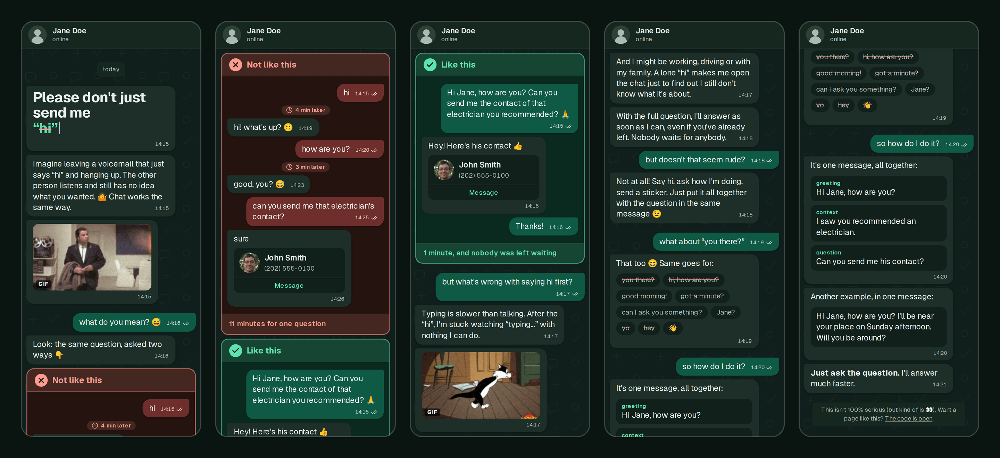

# nohello

[](https://github.com/kimtiago/nohello/actions/workflows/ci.yml)
[](LICENSE)

> Please don't just send me “hi”. Send the greeting and the question together.

A page of your own to send when someone messages you just “hi” and leaves you waiting. Instead of a lecture, the page is
itself a chat conversation: it shows the same question asked the wrong way and the right way, and ends with a simple formula for
the next message. It's made for people who get the link on WhatsApp and open it on their phone.



## Features

- **Your name and photo**, set through environment variables, with no code to change.
- **Six languages**: English, Brazilian Portuguese, Spanish, French, German and Italian. Set one, or let each visitor get their
  browser's language.
- **A link preview that sparks curiosity**, with a title, description and image that don't give away the subject.
- **Your favorite GIFs** in the conversation.
- **Light to host**: a static site with no database or backend, on Vercel, in Docker or on any static host.
- **Out of search results**: the page is meant to be sent by link, so it asks search engines not to index it.
- **Accessible**: every animation respects the reduced motion setting, and animated content is announced to screen readers.
- **An easter egg**: on a computer, type the word for “hi” in the page's language anywhere on the page. 😉

## Deploy

### Vercel

[](https://vercel.com/new/clone?repository-url=https%3A%2F%2Fgithub.com%2Fkimtiago%2Fnohello&project-name=nohello&env=NEXT_PUBLIC_OWNER_NAME,NEXT_PUBLIC_OWNER_PHOTO,NEXT_PUBLIC_GIF_1_URL,NEXT_PUBLIC_GIF_2_URL&envDefaults=%7B%22NEXT_PUBLIC_GIF_1_URL%22%3A%22https%3A%2F%2Fmedia.giphy.com%2Fmedia%2F6uGhT1O4sxpi8%2F200w.gif%22%2C%22NEXT_PUBLIC_GIF_2_URL%22%3A%22https%3A%2F%2Fmedia.giphy.com%2Fmedia%2F2uwZ4xi75JhxZYeyQB%2F200w.gif%22%7D&envDescription=Your%20full%20name%2C%20your%20photo%20URL%20and%20the%20GIFs%20in%20the%20conversation%2C%20which%20are%20already%20filled%20in.&envLink=https%3A%2F%2Fgithub.com%2Fkimtiago%2Fnohello%23configuration)

The button copies this repository to your GitHub, GitLab or Bitbucket account and publishes the site on your Vercel account.
It asks for your name, your photo URL and the GIFs, which are already filled in. You can add the other variables to the project later.

Since it's a copy, updates to this repository don't reach your site automatically. Vercel Analytics and Speed Insights
are optional: to use them, turn them on in the project dashboard.

### Docker

The [`kimtiago/nohello`](https://hub.docker.com/r/kimtiago/nohello) image is ready to use on `amd64` and `arm64`, with no code to download or build.

1. Download [`docker-compose.yml`](docker-compose.yml) and fill in its variables, described under [Configuration](#configuration).
2. Start the container:

    ```bash
    docker compose up -d
    ```

The site runs at <http://localhost:8080>. After changing a variable, run the same command again.

- Set `NEXT_PUBLIC_SITE_URL` to your public address. Without it, the link preview points to `localhost` and its image doesn't appear on WhatsApp.
- The language and name are applied by the page's JavaScript. If it's turned off or fails to load, the page shows in English with a generic name. The link preview isn't affected.
- The container doesn't handle HTTPS: to publish it on the internet, put a reverse proxy such as Caddy, Traefik or Nginx in front of it.

To build the image from the code instead: `docker build -t kimtiago/nohello:latest .`

### Other static hosts

`npm run build` generates the site in `out/`, ready for any static host. Set the variables before building.

## Configuration

| Variable                  | What it does                                                                                   | Without it                                                     |
| ------------------------- | ---------------------------------------------------------------------------------------------- | -------------------------------------------------------------- |
| `NEXT_PUBLIC_OWNER_NAME`  | Your full name, at the top of the conversation. The rest of the text only uses your first name | A generic name in the page's language                          |
| `NEXT_PUBLIC_OWNER_PHOTO` | Public URL of your photo (`http` or `https`)                                                   | A generic avatar                                               |
| `NEXT_PUBLIC_LANGUAGE`    | Language of the page: `en`, `pt-BR`, `es`, `fr`, `de` or `it`                                  | Each visitor's browser language                                |
| `NEXT_PUBLIC_GIF_1_URL`   | GIF after the voicemail comparison                                                             | No GIF there                                                   |
| `NEXT_PUBLIC_GIF_2_URL`   | GIF after the message about “typing…”                                                          | No GIF there                                                   |
| `NEXT_PUBLIC_SITE_URL`    | Public address of the site, used in link previews                                              | Vercel: the production domain. Docker: `http://localhost:8080` |

Where to set them depends on how you run the site:

- **Vercel**: in the project's environment variables. They're read at build time, so redeploy after changing them.
- **Docker**: in `docker-compose.yml`. They're applied when the container starts.
- **Running locally**: in `.env.local`, using `.env.example` as a template.

> **Tip:** to use your GitHub photo, add `.png` to your profile URL: `https://github.com/YOUR_USER.png`.

If the photo URL is empty, invalid or doesn't load, the page uses the generic avatar.

### Language

With `NEXT_PUBLIC_LANGUAGE` set, everyone sees the page in that language, including in the link preview.

Without it, each visitor sees their browser's language, or English if the page doesn't have it. The link preview can't
follow the browser of whoever receives the link, so it's always in English. If the people you send the link to share a
language, set the variable so the preview uses it too.

### GIFs

Use any public image URL. `.env.example` and `docker-compose.yml` start with two from [GIPHY](https://giphy.com): a lost John
Travolta and Sylvester pacing back and forth.

- They appear in a 16:9 frame, so prefer that format: anything beyond it gets cropped.
- Use a light file, because GIFs load with the page. On GIPHY, URLs ending in `200w.gif` are usually under 1 MB.
- If the URL is empty, invalid or doesn't load, the GIF's message doesn't appear. It also doesn't appear for people who
  asked for reduced motion.

## Development

Requires Node.js 24 (`nvm use`) and npm 11 or newer (the one that ships with Node 24 works).

```bash
npm install
npm run dev      # http://localhost:3000
npm run check    # lint + typecheck + prettier + markdownlint + tests
npm test         # language tests
npm run build    # static site in out/
```

Built with Next.js, React, Tailwind CSS and TypeScript. Instructions for AI coding agents are in [AGENTS.md](AGENTS.md), for any tool.

### Adding a language

1. Copy `src/i18n/locales/en.ts` to a file named after the language code, such as `nl.ts`, and translate it.
2. Register it in `src/i18n/index.ts`.
3. Add the code to the language lists in this README, `.env.example` and `docker-compose.yml`.

All of the page's text is in `src/i18n/locales/`, one file per language, so this is also where to change the wording.

## Changelog

See [CHANGELOG.md](CHANGELOG.md).

## License

[MIT](LICENSE)

## Credits

Inspired by [nohello.com](https://web.archive.org/web/20131127020115/http://www.nohello.com/) and [nohello.net](https://nohello.net/).
